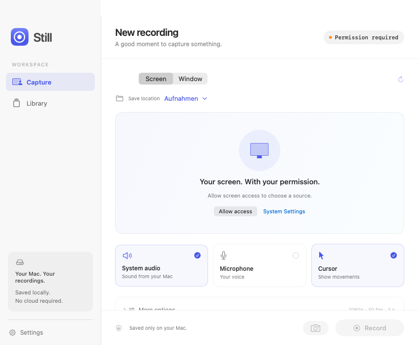

# Still

**A compact, native screen recorder for macOS.**

Record a screen or window, capture system audio and your microphone, and keep everything on your Mac. Still pairs a dependency-free Rust core with a native SwiftUI interface and Apple's ScreenCaptureKit. No webview, account, or cloud service.

<picture>
  <source media="(prefers-color-scheme: dark)" srcset="docs/images/capture-dark.png">
  
</picture>

## Features

- **Recording folders** — choose or create a subfolder before recording using the save-location control. Browse and create subfolders in Library; use the save-location button to save future recordings there. The destination persists across launches and stays within `Aufnahmen`. Native file dialogs also support creating folders while exporting.
- **Screen and window recording** — select one display or window, including on a multi-monitor setup.
- **Audio controls** — independently enable system audio and the default microphone.
- **Quality options** — MP4 with H.264 or HEVC; 24, 30, or 60 fps; 1080p, 1440p, 4K, or original resolution.
- **Helpful recording tools** — optional cursor, click highlights, countdown, automatic stop, and automatic app hiding.
- **Screenshots** — save the selected source as a PNG at its source resolution.
- **Convert and export** — export video as animated GIF or a still frame (PNG, JPEG, HEIC, TIFF, BMP), convert images, or export MP4/MOV/M4V. Use **Convert…** in a library item’s context menu or preview. GIF clips support a start time, up to 30 seconds, 12 fps, and 960 px. Export uses a native save panel, preserves originals, and supports cancellation. Available encoders depend on macOS.
- **Discard a recording** — choose **Delete current recording** from the Still menu bar icon to stop and permanently remove the current output after finalization.
- **Media library** — thumbnails, search, filters, video playback, sharing, file copying, Finder integration, and Move to Trash.
- **Menu bar controls** — see recording duration and stop a recording without returning to the main window.
- **Global shortcut** — start or stop with **⇧⌘R**, even while another app is active.
- **Native design** — light and dark appearances, system typography, SF Symbols, and familiar macOS controls.
- **18 built-in languages** — automatic language detection, an in-app language picker, and right-to-left layout for Arabic.

Additional settings stay tucked away under **More options** to keep everyday recording simple. The preview is a still image refreshed on source changes or on request; Still does not run a continuous preview stream or an idle recording timer.

## Requirements

- macOS **15.0 or later**.
- Rust **1.88 or later**, with Cargo and Rust 2024 edition support.
- Xcode Command Line Tools with Swift and a macOS 15+ SDK.
- Python 3 for the icon packer and localization checks.

The build targets the current Mac's architecture. The locally generated bundle is for Apple Silicon; the build script also selects `x86_64` when run on an Intel Mac. Universal builds and distribution packages are not included.

## Build and launch

From the repository root:

```sh
# Build an optimized, locally signed app.
./scripts/build.sh

# Open the app.
open build/Still.app
```

For a debug build:

```sh
./scripts/build.sh debug
```

The build needs no dependency downloads. It creates `build/Still.app` and signs it ad hoc for local use. Move the app to its intended location before granting permissions; changing or rebuilding an ad-hoc-signed app may cause macOS to request permission again.

To use a signing identity already available in your Keychain:

```sh
SIGNING_IDENTITY="Developer ID Application: Your Name (TEAMID)" ./scripts/build.sh
```

This only selects the code-signing identity. The script does not enable a distribution-ready hardened runtime, submit the app for notarization, or staple a ticket. Those steps must be added before public distribution.

## First recording

1. Click **Allow access**. Enable Still in **System Settings → Privacy & Security → Screen & System Audio Recording** if requested. Restart Still if macOS requires it.
2. Select **Screen** or **Window**, then choose a source. Use the refresh button if a source or preview is out of date.
3. Set system audio, microphone, and cursor visibility. Microphone permission is requested only when starting a recording with the microphone enabled.
4. Click **Record**, or press **⇧⌘R**. Stop with the same shortcut or the menu bar control.
5. Find the completed file in **Library**, where you can preview, share, or reveal it in Finder.

Closing the main window leaves Still available in the menu bar. Quitting during a recording asks whether to save the recording first.

| Action | Shortcut | Scope |
| --- | --- | --- |
| Start / stop recording | ⇧⌘R | Global |
| Save screenshot | ⇧⌘S | In Still |
| Open recordings in Finder | ⇧⌘O | In Still |
| Settings | ⌘, | In Still |
| Quit | ⌘Q | In Still |

If another app prevents the global shortcut from being registered, use the app or menu bar controls.

## Languages

Still follows your preferred macOS language by default and falls back to English when no supported language matches. Override it under **Settings → Language**; changes apply immediately and persist across launches. Changing language is disabled during recording.

| Language | Code | Language | Code |
| --- | --- | --- | --- |
| English | `en` | German | `de` |
| Spanish | `es` | French | `fr` |
| Italian | `it` | Portuguese (Brazil) | `pt-BR` |
| Dutch | `nl` | Polish | `pl` |
| Russian | `ru` | Ukrainian | `uk` |
| Turkish | `tr` | Arabic | `ar` |
| Hindi | `hi` | Chinese (Simplified) | `zh-Hans` |
| Chinese (Traditional) | `zh-Hant` | Japanese | `ja` |
| Korean | `ko` | Indonesian | `id` |

The recording interface, library, settings, custom menus, statuses, and app error messages are localized. Permission descriptions are included in each language's `InfoPlist.strings`. System-provided permission dialogs and macOS-owned interface elements follow the system's app language, independently of Still's in-app override. File names, paths, and source window titles are preserved.

Translations are bundled with the app and work offline. To improve a translation, edit `native/Resources/<code>.lproj/Localizable.strings` and the corresponding `InfoPlist.strings`, then run `python3 scripts/check-localizations.py`. Keep `%d` and `%@` placeholders in their original order. For a new language, also add its identifier and native name to `native/Localization.swift`.

## Privacy and storage

Still has no networking, telemetry, account, or cloud upload. Recordings and screenshots stay local until you choose to share them through macOS.

| Data | Location |
| --- | --- |
| Recordings and screenshots | `~/Movies/Still/Aufnahmen/` |
| Recording settings | `~/Movies/Still/settings.v1` |
| Recording destination | `~/Movies/Still/destination.v1` |
| Language preference | `~/Movies/Still/language.txt` |

The existing `Aufnahmen` folder name remains the same in every language so updates never move or split your library. Still excludes its own application from display recordings and excludes its own audio from system audio capture.

When recording fails, an existing incomplete output is marked with a `.failed` extension and kept in the recordings folder for possible recovery. It does not appear as a successful item in the library. Moving a library item to Trash uses the macOS Trash and can be undone in Finder.

## Architecture

| Component | Responsibility |
| --- | --- |
| `src/lib.rs` | Rust state machine, countdown, time limit, validated settings, output paths, media library, and C ABI |
| `native/StillCore.h` | Shared ABI and owned-string interface |
| `native/CaptureModel.swift` | Swift/Rust adapter, ScreenCaptureKit, audio permissions, and file actions |
| `native/Views.swift` | Recording, library, playback, and settings views |
| `native/StillApp.swift` | App lifecycle, menu bar, commands, and Carbon global hotkey |
| `native/Localization.swift` | Language matching, English fallback, formatting, and layout direction |
| `native/Resources/` | Native `.lproj` string catalogs and permission descriptions |

FFI calls run serially on the main actor. The elapsed-time clock starts only after ScreenCaptureKit confirms recording has begun. Stopping waits for the output-finalization callback before adding the recording to the library. Idle system sleep is prevented during recording and preparation.

The interface follows Apple's [Human Interface Guidelines](https://developer.apple.com/design/human-interface-guidelines), with familiar controls, visible recording status, and progressive disclosure of advanced options. Capture uses [ScreenCaptureKit](https://developer.apple.com/documentation/screencapturekit/capturing-screen-content-in-macos).

## Validation

```sh
./scripts/check.sh
```

The check script runs:

- Localization validation for all 18 languages: complete key sets, nonempty values, compatible format placeholders, and permission descriptions.
- Rust formatting, six unit tests, and Clippy with warnings treated as errors.
- A debug app build, bundle metadata validation, and code-signature verification.
- Synthetic conversion tests for image formats, animated GIF, frame extraction, MP4/MOV/M4V, original preservation, and staging cleanup.
- Native Swift/Rust smoke tests covering language matching, persistence, English fallback, right-to-left direction, translated Rust errors, and light/dark rendering.

In restricted build sandboxes, HEIC and video codec services may be unavailable. To run the remaining checks explicitly, use `STILL_SKIP_HEIC_TEST=1 STILL_SKIP_VIDEO_TEST=1 ./scripts/check.sh`; skipped codec checks are reported and must be run on a normal Mac before claiming full export validation.

Rendered previews are written to `build/previews/`. These tests render only the app's own views and never request screen-recording access or capture the desktop. The English screenshots in this README are generated from that permission-free preview.

Real screen/window recording, audio capture, and system permission flows need interactive testing on a Mac. See the [manual test checklist](docs/manual-test.md). App-bundle launching can be restricted in sandboxed build environments even when builds and native view rendering succeed; launch the bundle from your own Finder or Terminal.

## Current limits

- No region selection, video trimming, webcam overlay, or pause/resume yet.
- Output is SDR. Sources are never upscaled. H.264 output is capped at 3840 pixels wide; HEVC at 7680 pixels wide.
- System audio and microphone use the Mac's default devices.
- Protected content may appear black. Closed or minimized windows can become unavailable.
- Language checks verify completeness and formatting; native-speaker review of translations is welcome.
